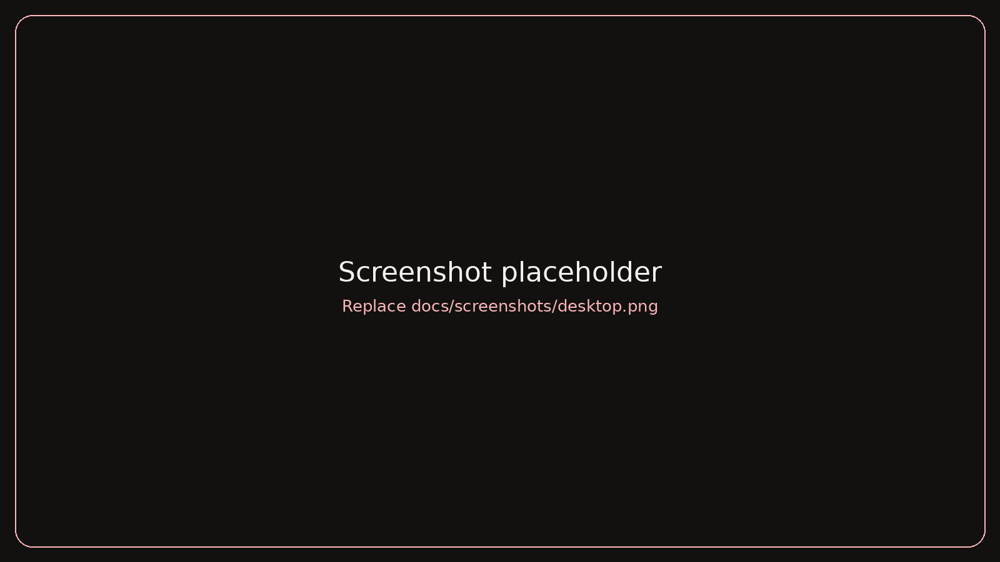
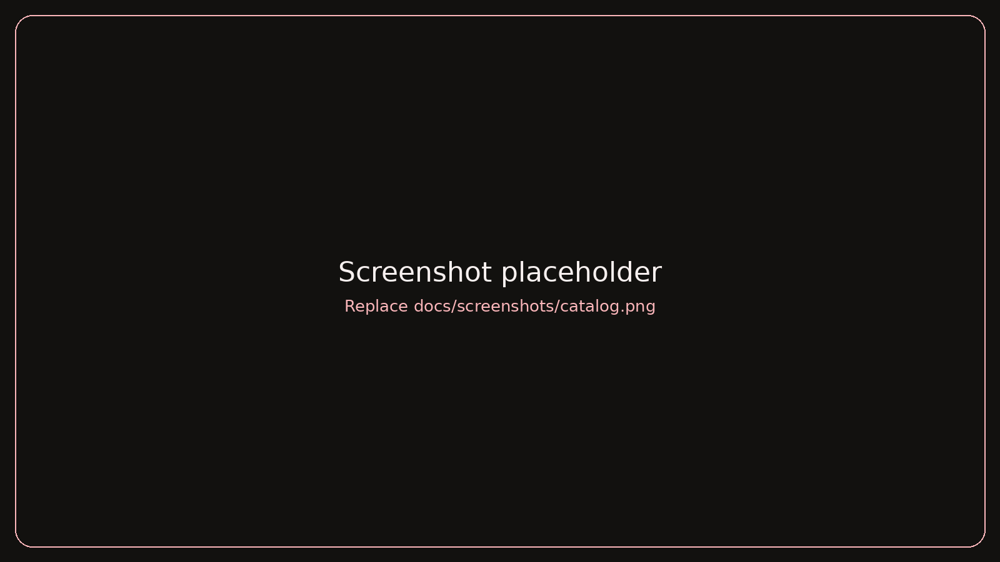
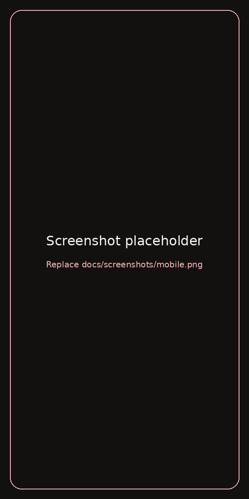

<div align="center">


<br>

[](https://YOUR-USERNAME.github.io/YOUR-REPO/)
[](#-deploy-in-3-minutes)
[](https://github.com/YOUR-USERNAME/YOUR-REPO/issues)


**A dark, elegant landing page and catalog for a flower shop.**
Static files only — upload to GitHub, enable Pages, done.

</div>

> **First step after you upload.** Replace `YOUR-USERNAME` and `YOUR-REPO` in this file with your GitHub username and repository name, so the buttons and badges above start working.
> ```bash
> sed -i 's/YOUR-USERNAME/octocat/g; s/YOUR-REPO/bloomora/g' README.md   # macOS: sed -i '' ...
> ```

<details>
<summary><b>Table of contents</b></summary>

- [Highlights](#-highlights)
- [Preview](#-preview)
- [Deploy in 3 minutes](#-deploy-in-3-minutes)
- [Run locally](#-run-locally)
- [Customization](#-customization)
- [Project structure](#-project-structure)
- [Tech stack](#-tech-stack)
- [Accessibility and performance](#-accessibility-and-performance)
- [Troubleshooting](#-troubleshooting)
- [Roadmap](#-roadmap)
- [Credits and license](#-credits-and-license)
- [Author](#-author)

</details>

## ✨ Highlights

| | |
| --- | --- |
| 🌸 **Hero section** | Entrance animation, soft parallax and floating petals |
| 💐 **Bouquet catalog** | Filters: Classic, Signature, Monobouquets and Favorites |
| ❤️ **Favorites** | Saved in the browser (`localStorage`) with a live counter |
| 📖 **Detail panel** | Composition, colors, structure, occasion and care tips for every bouquet |
| 💬 **Inquiry form** | Opens WhatsApp with a prefilled message |
| 📱 **Responsive** | Phones, tablets and wide desktops, mobile menu included |
| ⌨️ **Keyboard friendly** | `Tab` to focus cards, `Enter` / `Space` to open, `Esc` to close |
| 🌙 **Reduced motion** | Animations switch off for users who prefer less movement |

## 🖼 Preview

| Desktop | Catalog | Mobile |
| :---: | :---: | :---: |
|  |  |  |

> 📌 These are placeholders. Take screenshots of the running site and save them over `docs/screenshots/desktop.png`, `catalog.png` and `mobile.png` (same names, no README changes needed).

<details>
<summary>Original design mockup</summary>


</details>

## 🚀 Deploy in 3 minutes

The site is plain HTML, CSS and JavaScript. **No build, no Node.js, no installs.**

**Option A — in the browser (no tools needed)**

1. Create a new public repository on GitHub.
2. Click **Add file → Upload files**, drag **everything from this folder** (not the folder itself, so that `index.html` sits in the repository root) and commit.
3. Open **Settings → Pages**, choose **Deploy from a branch**, branch `main`, folder `/ (root)`, and save.

After about a minute your site is live at `https://YOUR-USERNAME.github.io/YOUR-REPO/`.

**Option B — Git**

```bash
git init
git add .
git commit -m "Initial commit: Bloomora"
git branch -M main
git remote add origin https://github.com/YOUR-USERNAME/YOUR-REPO.git
git push -u origin main
```

Then enable Pages as in step 3 above.

> GitHub Pages serves the file named `index.html` from the published folder. That is why the entry point of this project is `index.html` in the root.

## 💻 Run locally

Open `index.html` in a browser, or use a local server (recommended):

```bash
python3 -m http.server 8000      # then open http://localhost:8000
# or
npx serve .
```

## 🎨 Customization

<details>
<summary><b>Hero photo</b></summary>

Replace `assets/img/hero.jpg`. Recommended: 2000 px wide or more, a dark background, the subject on the right. The page background is `--bg` in `assets/css/style.css`; match it to the photo edges for a seamless blend.

</details>

<details>
<summary><b>Bouquets</b></summary>

Edit `assets/js/data.js`. The key is the bouquet name:

```js
"Soft Morning": {
  cat: "Классика",        // "Классика" | "Авторский букет" | "Монобукет"
  price: "от 4 500 ₽",
  img: "https://example.com/photo.jpg",
  lead: "Short text shown on the card.",
  composition: "What is inside the bouquet.",
  palette: "Colors and mood.",
  layout: "How it is assembled.",
  occasion: "Who it is for.",
  care: "How to keep it fresh."
}
```

Category names are filter keys and must match exactly.

</details>

<details>
<summary><b>Contacts</b></summary>

The phone and WhatsApp number are placeholders (`70000000000`). Change them in `index.html` (Contacts section and footer) and in `assets/js/main.js` (search for `wa.me`).

</details>

<details>
<summary><b>Colors and fonts</b></summary>

Design tokens live in `:root` at the top of `assets/css/style.css`:

```css
--bg: #12110f;     /* page background */
--panel: #1a1716;  /* cards and panels */
--pink: #fbb6ba;   /* accent */
```

</details>

<details>
<summary><b>Texts</b></summary>

The Delivery and Reviews sections contain sample text. Replace it with real information and real customer reviews before publishing.

</details>

## 🗂 Project structure

```text
.
├── index.html              # entry point (GitHub Pages serves this file)
├── favicon.svg
├── robots.txt
├── .nojekyll               # tells GitHub Pages to serve files as they are
├── assets/
│   ├── css/style.css       # styles and design tokens
│   ├── js/
│   │   ├── data.js         # bouquet catalog data
│   │   ├── motion.js       # GSAP animations
│   │   └── main.js         # catalog, filters, favorites, panel, form
│   └── img/hero.jpg        # hero photo
├── docs/
│   ├── banner.png
│   └── screenshots/        # README images + design mockup
├── LICENSE
└── README.md
```

## 🛠 Tech stack

| Area | Tools |
| --- | --- |
| Markup and styles | HTML5, CSS3 (custom properties, grid, flexbox) |
| Logic | Vanilla JavaScript |
| Animation | [GSAP](https://gsap.com/) + ScrollTrigger (cdnjs, pinned version 3.12.5) |
| Fonts | Cormorant Garamond, Manrope (Google Fonts) |
| Hosting | GitHub Pages |

No heavy frameworks on purpose: a single content page loads faster and is easier to maintain without them.

## ♿ Accessibility and performance

- Semantic structure, `aria-label` on icon buttons, visible focus outlines.
- `prefers-reduced-motion` respected for animations and smooth scrolling.
- Lazy loading for catalog images; the hero image loads with high priority.
- The site still works if the GSAP CDN is unavailable; only the animations are skipped.

## 🧯 Troubleshooting

| Problem | Fix |
| --- | --- |
| Pages shows a 404 | Check that `index.html` is in the repository **root** and Pages is set to branch `main`, folder `/ (root)`. |
| Styles or images are missing | File names are case-sensitive on GitHub. Keep the folder structure unchanged. |
| Fonts look different | Fonts load from Google Fonts and need an internet connection. |
| Changes are not visible | Wait a minute for Pages to rebuild, then hard refresh (`Ctrl/Cmd + Shift + R`). |
| WhatsApp opens the wrong number | Update the number in `assets/js/main.js` and `index.html`. |

## 🗺 Roadmap

- [x] Responsive layout and mobile menu
- [x] Catalog with filters and favorites
- [x] Bouquet detail panel
- [ ] Real photos and real customer reviews
- [ ] Search in the catalog
- [ ] Online ordering and payment
- [ ] SEO: sitemap and structured data

## 📄 Credits and license

- Catalog photos: [Unsplash](https://unsplash.com/) contributors. Use your own photos for a commercial project.
- Fonts: [Cormorant Garamond](https://fonts.google.com/specimen/Cormorant+Garamond) and [Manrope](https://fonts.google.com/specimen/Manrope), SIL Open Font License.
- Code is released under the [MIT License](LICENSE). Put your name in the `LICENSE` file.

## 👤 Author

**Your Name** — [GitHub](https://github.com/YOUR-USERNAME) · [Email](mailto:you@example.com)

<div align="center">

<sub>Made with 🌸 and a lot of care</sub>

</div>
